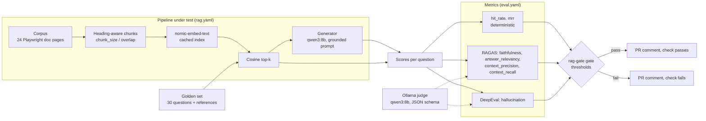

# rag-eval-gate

A small RAG pipeline over the Playwright Python docs with a quality gate: every pull request that changes retrieval is scored with RAGAS and DeepEval by a local judge model, gets the metrics as a PR comment, and fails when a metric breaks its threshold.

[](https://github.com/Gabnagawo/rag-eval-gate/actions/workflows/ci.yml)

[](LICENSE)

## Why

A RAG change is a one-line diff: `top_k: 4` becomes `top_k: 1`, a chunk size is
halved, a prompt is reworded. Unit tests still pass, the demo question still gets
a plausible answer, and nobody can tell from the diff whether answers got worse.

This repository treats that diff like any other regression risk:

- the pipeline under test is one file, `rag.yaml`, so a retrieval change is visible in review;
- a **golden set** of 30 questions with reference answers is scored on every change with
  two deterministic retrieval metrics and five LLM-judged metrics (RAGAS and DeepEval);
- thresholds live in `eval.yaml`, and `rag-gate gate` exits 1 when one is broken, when a
  metric was not measured, or when more than 20 % of a metric's judge calls failed;
- the judge is a local Ollama model, so the gate costs nothing to run and no data leaves the machine;
- the thresholds were calibrated on two real runs, a baseline and a deliberately degraded
  retriever, and the result is reported as measured: **two of seven metrics caught the
  degradation, four barely moved and one improved** (see [Results](#results)).

## How it works



1. **Corpus.** 24 pages of the Playwright docs (Apache-2.0, pinned to upstream commit
   `9a82788`), reduced to their Python content and committed under `data/corpus/`.
2. **Pipeline.** Chunks follow the heading structure; embeddings are `nomic-embed-text`
   with its task prefixes, one input per request, cached on disk; retrieval is cosine
   top-k; the generator answers only from the retrieved passages.
3. **Golden set.** `eval/golden.yaml` holds 30 questions, each with a reference answer,
   the page that answers it and an evidence string that a unit test checks against the corpus.
4. **Metrics.** `hit_rate` and `mrr` need no model. RAGAS 0.4 scores faithfulness, answer
   relevancy, context precision and context recall; DeepEval 4.3 scores hallucination.
   Both frameworks are routed through one Ollama client that sends the same `num_ctx` on
   every request, runs one request at a time and asks for JSON matching each framework's schema.
5. **Gate.** `rag-gate gate` compares the results with the thresholds of the profile, adds
   a baseline/PR/delta table computed on the same questions, and sets the exit code.
   `.github/workflows/rag-eval.yml` runs it on pull requests and posts the table as a sticky comment.

| Command | What it does |
|---|---|
| `rag-gate index` | chunk and embed the corpus (cached) |
| `rag-gate ask "<question>"` | answer one question and list the retrieved passages |
| `rag-gate eval` | answer and score the golden questions; resumable with `--resume` |
| `rag-gate gate <results.json>` | check thresholds, print the PR comment, exit 0 or 1 |
| `rag-gate corpus fetch` / `corpus build` | rebuild the corpus from the pinned upstream commit |

## Quick start

Requires Python 3.12, [uv](https://docs.astral.sh/uv/) and [Ollama](https://ollama.com)
with `ollama pull qwen3:8b` and `ollama pull nomic-embed-text`.

```bash
git clone https://github.com/Gabnagawo/rag-eval-gate && cd rag-eval-gate
uv sync
uv run rag-gate eval --profile ci --out results/demo.json && uv run rag-gate gate results/demo.json --baseline docs/results/baseline.json
```

The third line is `make demo`: it scores the first 8 golden questions and runs the gate,
as the PR workflow does. Without Ollama, `uv run rag-gate eval --offline --out results/offline.json`
scores the two retrieval metrics with hash embeddings and no model.

Windows has no `make`, so every target is also a `uv run` command:

| Task | make | uv |
|---|---|---|
| unit tests + coverage (no model needed) | `make test` | `uv run pytest` |
| lint, format check, types | `make lint typecheck` | `uv run ruff check . && uv run ruff format --check . && uv run mypy` |
| ask one question | `make ask` | `uv run rag-gate ask "How do I wait for a popup window opened by a click?"` |
| full evaluation, 30 questions | `make eval` | `uv run rag-gate eval --profile local --out results/eval.json --resume` |
| gate against the baseline | `make gate` | `uv run rag-gate gate results/eval.json --baseline docs/results/baseline.json` |
| retrieval metrics without a model | `make offline` | `uv run rag-gate eval --offline --out results/offline.json` |

Configuration is two files and a few environment variables ([.env.example](.env.example)):
`rag.yaml` is the pipeline, `eval.yaml` holds the metrics, profiles and thresholds, and
`LLM_PROVIDER=ollama|anthropic|openai` with `LLM_MODEL` selects the generator. The judge
is always Ollama.

## Example output

Real output of the demo on `main` (the baseline pipeline), saved in
[docs/results/demo-console.txt](docs/results/demo-console.txt). It ran here with
`--unload-every 3` because of this machine's memory (see Limitations); the run took
22 minutes and the gate passed with exit code 0.

```text
$ uv run rag-gate eval --profile ci --unload-every 3 --out results/demo.json
rag-eval-gate 0.1.0: 8 questions, profile ci, generator ollama/qwen3:8b, judge qwen3:8b, top_k 4, chunk_size 1200, 235 chunks
[ 1/8] custom-test-id-attribute   hit_rate=1.00  mrr=1.00  faithfulness=1.00  answer_relevancy=0.87  context_precision=0.83  context_recall=1.00  hallucination=0.75  (245 s)
[ 2/8] popup-window               hit_rate=1.00  mrr=1.00  faithfulness=1.00  answer_relevancy=0.84  context_precision=0.92  context_recall=1.00  hallucination=0.25  (128 s)
[ 3/8] new-tab-in-context         hit_rate=1.00  mrr=1.00  faithfulness=1.00  answer_relevancy=0.89  context_precision=0.81  context_recall=1.00  hallucination=0.25  (164 s)
[ 4/8] dialogs-default            hit_rate=1.00  mrr=1.00  faithfulness=1.00  answer_relevancy=0.83  context_precision=1.00  context_recall=1.00  hallucination=0.75  (167 s)
[ 5/8] download-save              hit_rate=1.00  mrr=1.00  faithfulness=1.00  answer_relevancy=0.86  context_precision=1.00  context_recall=1.00  hallucination=0.50  (182 s)
[ 6/8] download-lifetime          hit_rate=1.00  mrr=1.00  faithfulness=1.00  answer_relevancy=0.98  context_precision=1.00  context_recall=1.00  hallucination=0.50  (134 s)
[ 7/8] full-page-screenshot       hit_rate=1.00  mrr=1.00  faithfulness=1.00  answer_relevancy=0.88  context_precision=1.00  context_recall=1.00  hallucination=0.50  (147 s)
[ 8/8] screenshot-buffer          hit_rate=1.00  mrr=1.00  faithfulness=1.00  answer_relevancy=0.92  context_precision=1.00  context_recall=1.00  hallucination=1.00  (165 s)
hit_rate           1.000  (n=8)
mrr                1.000  (n=8)
faithfulness       1.000  (n=8)
answer_relevancy   0.885  (n=8)
context_precision  0.945  (n=8)
context_recall     1.000  (n=8)
hallucination      0.562  (n=8)
judge/LLM requests: 108 (2 empty completions, 2 aborted, 8 runner reloads, 0 answered by a JSON fallback); results: results/demo.json
(exit 0)
```

The gate on the degraded run (`top_k: 1`, `chunk_size: 300`), as it would appear in the
pull request. Real output of
`uv run rag-gate gate docs/results/degraded.json --baseline docs/results/baseline.json`,
saved in [docs/results/gate-degraded.md](docs/results/gate-degraded.md); exit code 1.

> ### ❌ RAG eval gate failed
>
> Profile `local`, 30 golden questions, generator `ollama/qwen3:8b`, judge `qwen3:8b`, embeddings `nomic-embed-text`, top_k 1, chunk_size 300.
>
> | Metric | Baseline | This PR | Δ | Threshold | Status |
> |---|---|---|---|---|---|
> | faithfulness | 0.943 | 0.576 | -0.367 | >= 0.85 | **FAIL** (below 0.85) |
> | context_recall | 0.967 | 0.750 | -0.217 | >= 0.85 | **FAIL** (below 0.85) |
> | hit_rate | 0.967 | 0.900 | -0.067 | >= 0.80 | pass |
> | mrr | 0.922 | 0.900 | -0.022 | >= 0.75 | pass |
> | answer_relevancy | 0.876 | 0.864 | -0.012 | >= 0.70 | pass |
> | context_precision | 0.893 | 0.867 | -0.026 | >= 0.70 | pass |
> | hallucination | 0.590 | 0.933 | +0.343 | >= 0.40 | pass |
>
> Thresholds live in `eval.yaml`; the pipeline under test is `rag.yaml`. All metrics are higher-is-better (DeepEval 4.x scores hallucination as agreement).

## Results

All numbers come from runs made in this repository on 2026-11-12 and 2026-11-13. Raw
output is in [docs/results/](docs/results/). Machine: Windows 11, AMD Ryzen 5 4500,
16 GB RAM, Radeon RX 580 8 GB, Ollama 0.40.16 (Vulkan), Python 3.12.10, RAGAS 0.4.3,
DeepEval 4.3.4. Generator and judge: `qwen3:8b`, `num_ctx` 16384, thinking off, seed 42.
Embeddings: `nomic-embed-text`.

### Baseline vs degraded retriever (30 questions)

The same golden set, corpus, generator and judge; only `rag.yaml` differs.

| Metric | Baseline (top_k 4, chunk 1200/150) | Degraded (top_k 1, chunk 300/50) | Delta | Questions worse / better | Threshold | Gate on degraded |
|---|---|---|---|---|---|---|
| faithfulness | **0.943** | **0.576** | -0.367 | 21 / 1 | >= 0.85 | **fail** |
| context_recall | **0.967** | **0.750** | -0.217 | 9 / 1 | >= 0.85 | **fail** |
| hit_rate | 0.967 | 0.900 | -0.067 | 2 / 0 | >= 0.80 | pass |
| mrr | 0.922 | 0.900 | -0.022 | 2 / 1 | >= 0.75 | pass |
| answer_relevancy | 0.876 | 0.864 | -0.012 | 15 / 10 | >= 0.70 | pass |
| context_precision | 0.893 | 0.867 | -0.026 | 3 / 5 | >= 0.70 | pass |
| hallucination (agreement, higher is better) | 0.590 | 0.933 | +0.343 | 2 / 21 | >= 0.40 | pass |

The baseline passes all seven checks; the degraded run fails two. No judge call failed
in either final result file.

Reading the numbers:

- **Faithfulness and context recall caught the change.** With one 300-character chunk the
  generator still writes a full answer, so most claims are no longer supported by the
  context, and the context covers less of the reference answer. These two thresholds sit
  between the runs and are the ones that gate this kind of change.
- **Four metrics did not separate the runs.** `hit_rate` and `mrr` lost two questions: the
  golden set marks an answering *page*, so a small chunk from the right page counts as a
  hit even when it lacks the answer. `answer_relevancy` and `context_precision` moved
  within noise. Their thresholds are regression floors that both runs pass.
- **The hallucination metric improved in the degraded run.** In DeepEval 4.x the
  `HallucinationMetric` score is the share of retrieved contexts the answer *agrees*
  with, so higher is better (older versions reported the opposite, and the name still
  suggests lower is better). With four contexts an answer rarely agrees with all of them
  (0.590); with a single context the score is 0 or 1 and usually 1 (0.933). The metric
  rewards a smaller context here, so it cannot be used to catch this regression.

The calibration, the margins and its limits are in [docs/THRESHOLDS.md](docs/THRESHOLDS.md).

### Reproduce

```bash
# baseline (main): 30 questions -> docs/results/baseline.json, baseline-console.txt
uv run rag-gate eval --profile local --out results/baseline.json
# degraded: same command on the branch demo/degraded-retriever -> docs/results/degraded.json
git switch demo/degraded-retriever
uv run rag-gate eval --profile local --out results/degraded.json --resume
git switch main
# the two gates -> docs/results/gate-baseline.md (exit 0), gate-degraded.md (exit 1)
uv run rag-gate gate docs/results/baseline.json
uv run rag-gate gate docs/results/degraded.json --baseline docs/results/baseline.json
```

### Other measurements

| Metric | Result | Reproduce |
|---|---|---|
| Baseline run | 30 questions, 393 LLM requests, 83 min, 0 failed judge calls | [baseline-console.txt](docs/results/baseline-console.txt) |
| Degraded run | 30 questions over four resumed passes (two stopped by the host memory guard, one by hand); 33 to 170 s per question; 0 failed judge calls in the final file | [degraded-console.txt](docs/results/degraded-console.txt) |
| Judge repeatability, spot check | 3 baseline questions re-scored: 14 of 15 judged scores identical, one moved from 1.00 to 0.92 | [spotcheck-baseline-console.txt](docs/results/spotcheck-baseline-console.txt) |
| Demo (`ci` profile, 8 questions) | gate passed, 7 of 7 checks; 108 LLM requests, 22 min, 0 failed judge calls (2 empty completions, 2 aborts, 8 runner reloads, no fallback answer) | `make demo` -> [demo-console.txt](docs/results/demo-console.txt) |
| Unit tests | **84 passed**, line + branch coverage **98.38 %** (CI gate: 80 %) | `uv run pytest` -> [pytest.txt](docs/results/pytest.txt) |
| Lint / types | ruff check and format clean, mypy `--strict` clean | [lint.txt](docs/results/lint.txt) |
| PR workflow on a GitHub-hosted runner (duration, pass/fail) | to be measured (the repository is not published yet) | [docs/DEMO-PR.md](docs/DEMO-PR.md) |
| Hosted generators (Anthropic, OpenAI) | to be measured | `LLM_PROVIDER=anthropic uv run rag-gate eval` |

### A judge that returned nothing

The first degraded run lost every LLM-judged score. The Ollama server log showed its
runner raising `Unexpected empty grammar stack` on structured requests and answering
HTTP 200 with an empty message; unconstrained requests on the same runner were aborted
with `token repeat limit reached`. Both started a few minutes after a model load, and a
freshly loaded runner answered the same requests. The client now retries with a new seed,
reloads the runner after a failed completion, and falls back to JSON mode and then to an
unconstrained request; `rag-gate eval` prints how often each happened. The server-side
cause was not identified. The investigation, with the log excerpt and what was ruled
out, is in [docs/JUDGE-EMPTY-COMPLETIONS.md](docs/JUDGE-EMPTY-COMPLETIONS.md).

## Limitations

- **One run per configuration.** Thirty questions, one seed, one judge. A single question
  moves a mean by 0.033, and run-to-run variance over the full set was not measured. The
  thresholds were set after seeing both runs, on the same questions.
- **The judge is the generator's model.** `qwen3:8b` (8.2B parameters, Q4_K_M) judges its own answers.
  A stronger or different judge would be a better reference; none is available locally.
- **Only two of seven metrics detected this degradation**, and one moved the wrong way.
  A gate built on any of the other five alone would have passed the degraded retriever.
- **Page-level retrieval labels.** `hit_rate` and `mrr` check that a chunk comes from the
  answering page, not that it contains the answer, so they are insensitive to chunk size.
- **Small corpus.** 24 documentation pages and 30 questions about one library. The
  numbers describe this pipeline, not RAG quality in general.
- **Low-RAM machines.** A loaded `qwen3:8b` runner with `num_ctx` 16384 used about 8 GB of
  private memory on this 16 GB machine, and the host stopped the degraded run twice. Judge
  faults appeared only on runners loaded for a few minutes. A profile can set
  `unload_every: N` in `eval.yaml` (off by default; 3 in the `local` profile, or
  `--unload-every N`) to unload the models after every N questions, which costs one model
  load each time, and `OLLAMA_RELOAD_ON_FAULT` (on by default) reloads after a failed
  completion. On an Ollama server shared with other clients, turn both off.
- **The JSON fallback is less strict.** When the schema-constrained request fails, the
  judge answer is accepted from JSON mode or free text if it parses and validates. The
  last pass of the degraded run used no fallback answer; earlier passes did not record
  that counter.
- **CI was not run on GitHub.** The workflows were written and reviewed, not executed;
  pulling `qwen3:8b` (about 5 GB) and judging 8 questions on a CPU runner may be slow.
  The Dockerfile was not built here and hadolint was not run locally.

## Roadmap

- Open the demo pull request from `demo/degraded-retriever` after publishing and record the workflow run ([docs/DEMO-PR.md](docs/DEMO-PR.md)).
- Repeat each configuration several times and gate on a confidence interval instead of a single mean.
- Passage-level labels in the golden set, so `hit_rate` and `mrr` react to chunking.
- A second, stronger judge (hosted) on a sample, to measure agreement with the local judge.
- Replace the hallucination metric with one that does not depend on the number of contexts.
- Cache judge verdicts by prompt hash, so unchanged questions are not re-judged on every PR.

## License

MIT, see [LICENSE](LICENSE). Copyright (c) 2026 Gabriel Nagawo. The corpus under
`data/corpus/` is derived from the Playwright documentation, Apache-2.0
([data/LICENSE-playwright-docs.txt](data/LICENSE-playwright-docs.txt), [data/corpus/SOURCE.md](data/corpus/SOURCE.md)).
